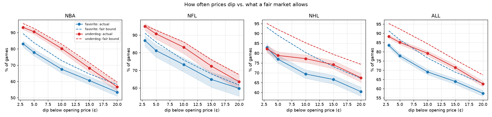
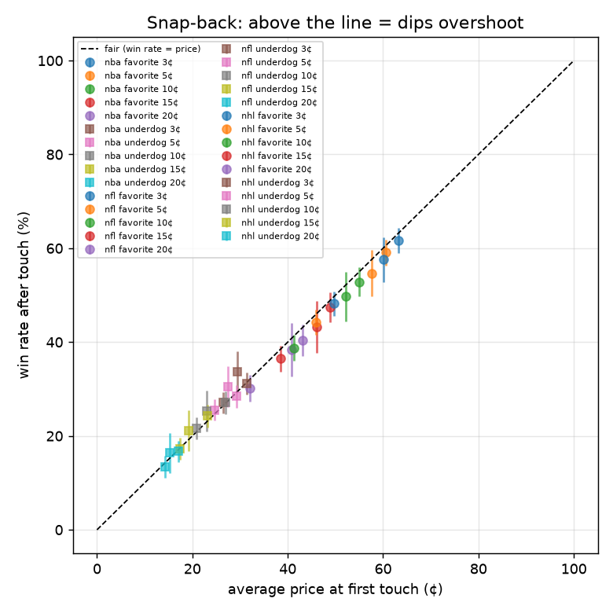
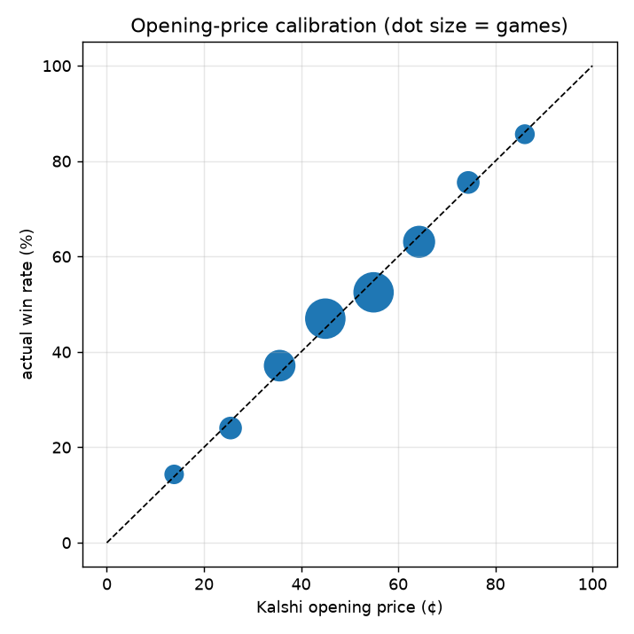
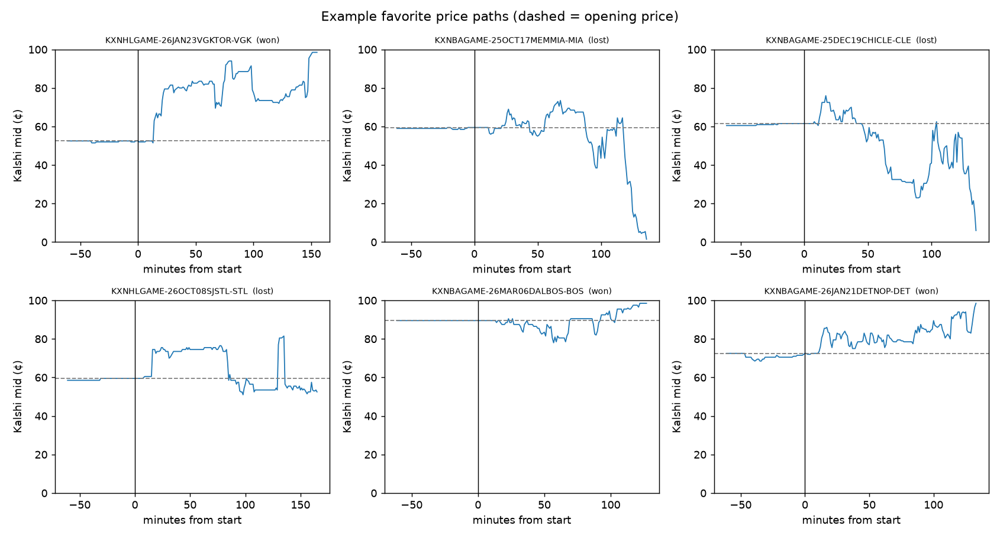

# In-game Kalshi price paths: dip and snap-back research

Generated 2026-11-05 01:36 UTC. Sports: nba, nhl, nfl. Up to 2000 games per sport, lookback 450 days, seed 42.

## Sample

| Sport | Games | Median in-game minutes | Median opening spread |
|---|---|---|---|
| nba | 1531 | 140 | 1.0¢ |
| nfl | 475 | 175 | 1.0¢ |
| nhl | 1738 | 154 | 1.0¢ |
| all | 3744 | 150 | 1.0¢ |

## 1. How far do prices move below the opening price?

"Never below open" allows a 1¢ wobble. "Winners" columns only count teams that went on to win, since a losing team always ends near 0.

| Sport | Side | Games | Never below open | Dip ≥3 | Dip ≥5 | Dip ≥10 | Dip ≥15 | Winners: never below | Winners: dip ≥5 | Winners: dip ≥10 |
|---|---|---|---|---|---|---|---|---|---|---|
| nba | favorite | 1531 | 11.4% | 83.1% | 77.7% | 67.3% | 60.4% | 16.7% | 67.4% | 52.3% |
| nba | underdog | 1531 | 4.8% | 93.1% | 89.8% | 77.3% | 65.6% | 15.0% | 71.9% | 52.5% |
| nfl | favorite | 475 | 8.2% | 86.9% | 81.3% | 73.3% | 64.8% | 13.0% | 70.3% | 57.7% |
| nfl | underdog | 475 | 4.0% | 94.5% | 90.3% | 80.8% | 69.7% | 10.3% | 74.9% | 55.4% |
| nhl | favorite | 1738 | 11.5% | 82.8% | 76.8% | 68.2% | 64.8% | 20.2% | 59.5% | 46.3% |
| nhl | underdog | 1738 | 12.4% | 80.7% | 76.7% | 74.6% | 70.7% | 27.0% | 50.7% | 47.0% |
| all | favorite | 3744 | 11.0% | 83.5% | 77.7% | 68.5% | 63.0% | 17.7% | 64.4% | 50.4% |
| all | underdog | 3744 | 8.2% | 87.5% | 83.8% | 76.5% | 68.5% | 20.8% | 61.1% | 49.9% |

### By opening price (all sports, one market per game per side)

| Opening price | Games | Win rate | Never below open | Dip ≥5 | Dip ≥10 | Winners: dip ≥5 |
|---|---|---|---|---|---|---|
| 0–20¢ | 377 | 14.3% | 3.2% | 89.7% | 57.0% | 63.0% |
| 20–30¢ | 520 | 24.0% | 4.8% | 90.8% | 84.0% | 66.4% |
| 30–40¢ | 1056 | 37.1% | 8.8% | 86.2% | 82.2% | 64.5% |
| 40–50¢ | 1769 | 47.0% | 10.1% | 79.1% | 75.1% | 58.6% |
| 50–60¢ | 1764 | 52.5% | 10.0% | 79.7% | 72.6% | 61.7% |
| 60–70¢ | 1089 | 63.1% | 9.7% | 80.5% | 69.4% | 69.3% |
| 70–80¢ | 523 | 75.5% | 10.3% | 76.3% | 66.5% | 68.6% |
| 80–100¢ | 390 | 85.6% | 19.5% | 63.1% | 50.3% | 56.9% |

## 2. Do prices dip more often than a fair market would?

Fair bound = average of (1 − p0) / (1 − (p0 − dip)). Real rates clearly ABOVE the bound mean overreaction. Rates below it are expected even in a fair market, because prices jump and minute closes miss some lows. A losing team counts as reaching every level, because it settles at $0 even when the last quote was higher.

| Sport | Side | Dip | Games | Actual dip rate (95% CI) | Fair bound | Actual − bound |
|---|---|---|---|---|---|---|
| nba | favorite | 3¢ | 1531 | 83.1% (81.2%–84.9%) | 89.4% | -6.2 pts |
| nba | favorite | 5¢ | 1531 | 77.8% (75.6%–79.8%) | 83.7% | -6.0 pts |
| nba | favorite | 10¢ | 1531 | 67.5% (65.1%–69.8%) | 72.8% | -5.3 pts |
| nba | favorite | 15¢ | 1531 | 60.5% (58.1%–63.0%) | 64.6% | -4.0 pts |
| nba | favorite | 20¢ | 1531 | 53.4% (50.9%–55.9%) | 58.1% | -4.7 pts |
| nba | underdog | 3¢ | 1531 | 93.2% (91.8%–94.4%) | 95.6% | -2.4 pts |
| nba | underdog | 5¢ | 1531 | 90.5% (89.0%–91.9%) | 92.6% | -2.0 pts |
| nba | underdog | 10¢ | 1531 | 80.2% (78.1%–82.1%) | 82.8% | -2.6 pts |
| nba | underdog | 15¢ | 1531 | 68.2% (65.8%–70.5%) | 71.3% | -3.1 pts |
| nba | underdog | 20¢ | 1531 | 56.7% (54.2%–59.2%) | 59.6% | -2.9 pts |
| nfl | favorite | 3¢ | 475 | 86.9% (83.6%–89.7%) | 91.1% | -4.1 pts |
| nfl | favorite | 5¢ | 475 | 81.3% (77.5%–84.5%) | 86.1% | -4.8 pts |
| nfl | favorite | 10¢ | 475 | 73.3% (69.1%–77.0%) | 75.9% | -2.6 pts |
| nfl | favorite | 15¢ | 475 | 64.8% (60.4%–69.0%) | 68.0% | -3.1 pts |
| nfl | favorite | 20¢ | 475 | 59.8% (55.3%–64.1%) | 61.6% | -1.9 pts |
| nfl | underdog | 3¢ | 475 | 94.9% (92.6%–96.6%) | 95.5% | -0.6 pts |
| nfl | underdog | 5¢ | 475 | 90.7% (87.8%–93.0%) | 92.8% | -2.0 pts |
| nfl | underdog | 10¢ | 475 | 83.2% (79.5%–86.3%) | 86.1% | -3.0 pts |
| nfl | underdog | 15¢ | 475 | 72.4% (68.2%–76.2%) | 76.0% | -3.6 pts |
| nfl | underdog | 20¢ | 475 | 63.6% (59.2%–67.8%) | 67.6% | -4.0 pts |
| nhl | favorite | 3¢ | 1738 | 82.9% (81.1%–84.6%) | 93.1% | -10.2 pts |
| nhl | favorite | 5¢ | 1738 | 76.9% (74.9%–78.8%) | 89.1% | -12.1 pts |
| nhl | favorite | 10¢ | 1738 | 69.4% (67.2%–71.5%) | 80.3% | -10.9 pts |
| nhl | favorite | 15¢ | 1738 | 66.6% (64.4%–68.8%) | 73.2% | -6.5 pts |
| nhl | favorite | 20¢ | 1738 | 60.4% (58.1%–62.7%) | 67.2% | -6.8 pts |
| nhl | underdog | 3¢ | 1738 | 82.2% (80.3%–83.9%) | 95.1% | -12.9 pts |
| nhl | underdog | 5¢ | 1738 | 78.8% (76.8%–80.7%) | 92.0% | -13.2 pts |
| nhl | underdog | 10¢ | 1738 | 77.2% (75.2%–79.1%) | 85.2% | -8.0 pts |
| nhl | underdog | 15¢ | 1738 | 74.2% (72.1%–76.2%) | 79.4% | -5.2 pts |
| nhl | underdog | 20¢ | 1738 | 67.5% (65.3%–69.7%) | 74.3% | -6.8 pts |
| all | favorite | 3¢ | 3744 | 83.5% (82.3%–84.7%) | 91.3% | -7.8 pts |
| all | favorite | 5¢ | 3744 | 77.8% (76.5%–79.1%) | 86.5% | -8.7 pts |
| all | favorite | 10¢ | 3744 | 69.1% (67.6%–70.6%) | 76.7% | -7.6 pts |
| all | favorite | 15¢ | 3744 | 63.9% (62.4%–65.4%) | 69.0% | -5.1 pts |
| all | favorite | 20¢ | 3744 | 57.5% (55.9%–59.1%) | 62.8% | -5.3 pts |
| all | underdog | 3¢ | 3744 | 88.3% (87.2%–89.3%) | 95.3% | -7.0 pts |
| all | underdog | 5¢ | 3744 | 85.1% (83.9%–86.2%) | 92.3% | -7.2 pts |
| all | underdog | 10¢ | 3744 | 79.2% (77.9%–80.5%) | 84.4% | -5.2 pts |
| all | underdog | 15¢ | 3744 | 71.5% (70.0%–72.9%) | 75.7% | -4.2 pts |
| all | underdog | 20¢ | 3744 | 62.6% (61.0%–64.1%) | 67.4% | -4.8 pts |

⬆ = the whole confidence interval sits above the fair bound.

## 3. Snap-back test: after a dip, does the team win more often than its price said?

For games whose price touched each dip level: win rate vs. the average price at first touch. In a fair market these match. "Buy-the-dip P&L" = buy YES at the ask at first touch and hold to settlement, per contract, before fees.

| Sport | Side | Dip | Touches | Win rate after touch | Avg touch price | Win rate − price | Buy-the-dip P&L (±1.96 SE) |
|---|---|---|---|---|---|---|---|
| nba | favorite | 3¢ | 1273 | 61.7% | 63.2% | -1.5 pts | -2.1¢ (±2.6¢) |
| nba | favorite | 5¢ | 1190 | 59.1% | 60.7% | -1.6 pts | -2.2¢ (±2.7¢) |
| nba | favorite | 10¢ | 1031 | 52.9% | 55.0% | -2.1 pts | -2.8¢ (±2.9¢) |
| nba | favorite | 15¢ | 925 | 47.5% | 48.9% | -1.4 pts | -2.1¢ (±3.1¢) |
| nba | favorite | 20¢ | 816 | 40.4% | 43.1% | -2.7 pts | -3.4¢ (±3.2¢) |
| nba | underdog | 3¢ | 1425 | 27.1% | 26.5% | +0.6 pts | +0.0¢ (±2.2¢) |
| nba | underdog | 5¢ | 1375 | 25.5% | 24.7% | +0.9 pts | +0.2¢ (±2.2¢) |
| nba | underdog | 10¢ | 1184 | 21.6% | 20.8% | +0.8 pts | +0.1¢ (±2.3¢) |
| nba | underdog | 15¢ | 1004 | 17.2% | 17.4% | -0.1 pts | -0.8¢ (±2.3¢) |
| nba | underdog | 20¢ | 798 | 13.4% | 14.2% | -0.8 pts | -1.5¢ (±2.3¢) |
| nfl | favorite | 3¢ | 413 | 57.6% | 60.1% | -2.5 pts | -3.2¢ (±4.7¢) |
| nfl | favorite | 5¢ | 386 | 54.7% | 57.6% | -3.0 pts | -3.7¢ (±4.9¢) |
| nfl | favorite | 10¢ | 348 | 49.7% | 52.1% | -2.4 pts | -3.2¢ (±5.2¢) |
| nfl | favorite | 15¢ | 308 | 43.2% | 46.0% | -2.8 pts | -3.6¢ (±5.5¢) |
| nfl | favorite | 20¢ | 284 | 38.4% | 40.7% | -2.4 pts | -3.1¢ (±5.6¢) |
| nfl | underdog | 3¢ | 449 | 33.6% | 29.5% | +4.1 pts | +3.4¢ (±4.3¢) |
| nfl | underdog | 5¢ | 429 | 30.5% | 27.5% | +3.0 pts | +2.3¢ (±4.2¢) |
| nfl | underdog | 10¢ | 384 | 25.3% | 23.1% | +2.2 pts | +1.4¢ (±4.2¢) |
| nfl | underdog | 15¢ | 331 | 21.1% | 19.2% | +1.9 pts | +1.2¢ (±4.3¢) |
| nfl | underdog | 20¢ | 281 | 16.4% | 15.2% | +1.2 pts | +0.4¢ (±4.3¢) |
| nhl | favorite | 3¢ | 1439 | 48.2% | 49.7% | -1.5 pts | -2.8¢ (±2.5¢) |
| nhl | favorite | 5¢ | 1334 | 44.2% | 45.9% | -1.6 pts | -3.1¢ (±2.6¢) |
| nhl | favorite | 10¢ | 1185 | 38.7% | 41.3% | -2.6 pts | -4.0¢ (±2.7¢) |
| nhl | favorite | 15¢ | 1127 | 36.5% | 38.4% | -2.0 pts | -3.2¢ (±2.8¢) |
| nhl | favorite | 20¢ | 1006 | 30.1% | 32.0% | -1.9 pts | -3.1¢ (±2.8¢) |
| nhl | underdog | 3¢ | 1402 | 31.2% | 31.4% | -0.3 pts | -1.7¢ (±2.4¢) |
| nhl | underdog | 5¢ | 1333 | 28.4% | 29.3% | -0.9 pts | -2.4¢ (±2.4¢) |
| nhl | underdog | 10¢ | 1296 | 27.1% | 26.9% | +0.2 pts | -1.1¢ (±2.4¢) |
| nhl | underdog | 15¢ | 1229 | 24.2% | 23.2% | +1.0 pts | -0.0¢ (±2.4¢) |
| nhl | underdog | 20¢ | 1089 | 16.7% | 17.1% | -0.4 pts | -1.6¢ (±2.2¢) |
| all | favorite | 3¢ | 3125 | 54.9% | 56.6% | -1.6 pts | -2.6¢ (±1.7¢) |
| all | favorite | 5¢ | 2910 | 51.7% | 53.5% | -1.8 pts | -2.8¢ (±1.8¢) |
| all | favorite | 10¢ | 2564 | 45.9% | 48.3% | -2.4 pts | -3.4¢ (±1.9¢) |
| all | favorite | 15¢ | 2360 | 41.7% | 43.5% | -1.8 pts | -2.8¢ (±1.9¢) |
| all | favorite | 20¢ | 2106 | 35.2% | 37.5% | -2.3 pts | -3.2¢ (±2.0¢) |
| all | underdog | 3¢ | 3276 | 29.7% | 29.0% | +0.7 pts | -0.3¢ (±1.5¢) |
| all | underdog | 5¢ | 3137 | 27.4% | 27.0% | +0.4 pts | -0.6¢ (±1.5¢) |
| all | underdog | 10¢ | 2864 | 24.6% | 23.9% | +0.7 pts | -0.2¢ (±1.5¢) |
| all | underdog | 15¢ | 2564 | 21.1% | 20.4% | +0.7 pts | -0.2¢ (±1.5¢) |
| all | underdog | 20¢ | 2168 | 15.5% | 15.8% | -0.3 pts | -1.3¢ (±1.5¢) |

## 4. Is the opening price itself well calibrated?

If Kalshi's pregame price is biased (e.g. favorites too cheap), the in-game tests above inherit that bias.

| Opening price | Games | Avg opening price | Win rate | Win rate − price |
|---|---|---|---|---|
| 0–20¢ | 377 | 13.9% | 14.3% | +0.5 pts |
| 20–30¢ | 520 | 25.5% | 24.0% | -1.4 pts |
| 30–40¢ | 1056 | 35.6% | 37.1% | +1.5 pts |
| 40–50¢ | 1769 | 45.0% | 47.0% | +2.0 pts |
| 50–60¢ | 1764 | 54.9% | 52.5% | -2.4 pts |
| 60–70¢ | 1089 | 64.3% | 63.1% | -1.2 pts |
| 70–80¢ | 523 | 74.4% | 75.5% | +1.1 pts |
| 80–100¢ | 390 | 86.1% | 85.6% | -0.4 pts |

## Plain-language read

- Dip-rate test: 0 of 10 all-sport dip levels show dips significantly more often than a fair market allows.
- Snap-back test: of 10 all-sport dip levels, 0 show a buy-the-dip profit clearly above zero, 5 clearly below zero, the rest are inside the noise.
- If both tests come back near zero, in-game swings are ordinary game volatility. A convergence exit would then mostly sell winners early, and holding the pregame edge to settlement is the better rule.
- If snap-back is clearly positive, Kalshi overreacts in-game, and buying dips (or exiting at the sharp number) has its own edge worth testing against fees and depth.
- Fees are not included. Kalshi's taker fee is largest near 50¢, so any edge under ~2¢ per contract is unlikely to survive taking liquidity.

## 5. Your logged signals: did Kalshi ever reach the book's fair price?

Entry = logged entry price. Target = logged book fair probability. Touch uses the bid/ask midpoint, so a real sell would land slightly lower. Before fees.

| Ticker | Entry | Target | Touched target? | Won? | Sell-at-target P&L | Hold P&L |
|---|---|---|---|---|---|---|
| KXMLBGAME-26SEP091915TBATL-ATL | 0.43 | 0.53 | no | no | -43.0¢ | -43.0¢ |
| KXMLBGAME-26SEP091840HOUPHI-PHI | 0.31 | 0.65 | yes | yes | +34.2¢ | +69.0¢ |
| KXNBAGAME-26OCT20BOSDET-DET | 0.50 | 0.53 | no | yes | +50.0¢ | +50.0¢ |
| **Average (3)** | | | | | **+13.7¢** | **+25.3¢** |

Too few rows to conclude anything yet; this table grows as the scanner logs more signals.

## Charts

